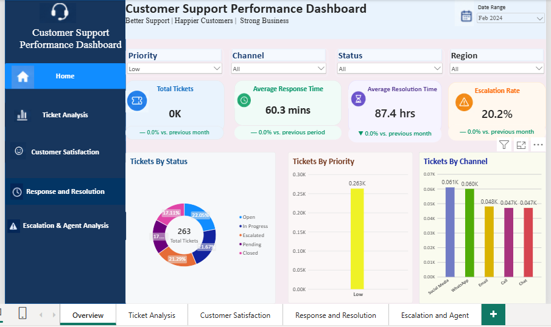
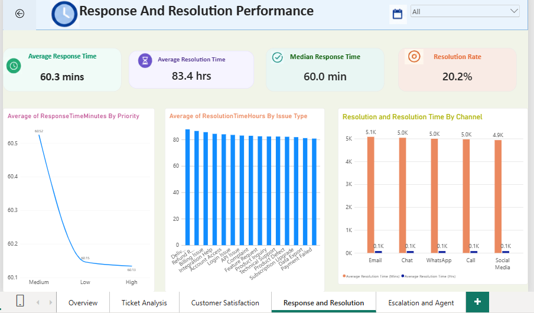

# 🎧 Customer Support Analytics Dashboard 📊

## 🌟 Project Overview

The **Customer Support Analytics Dashboard** is a data analysis and visualization project designed to understand customer support performance using ticket data.

This project analyzes ticket trends, issue types, priorities, customer satisfaction, response and resolution times, escalation patterns, and agent performance using Python and an interactive Power BI dashboard.

## 🎯 Project Objectives

- 🔍 Analyze customer support ticket data.
- 📌 Identify the most common customer issues.
- 📊 Understand ticket distribution by priority, channel, and status.
- ⭐ Evaluate customer satisfaction.
- ⏱️ Analyze response and resolution times.
- 🚨 Monitor escalations and agent performance.
- 📈 Present meaningful insights through interactive visualizations.

## 🛠️ Tools and Technologies

| Tool | Purpose |
|---|---|
| 🐍 Python | Data analysis |
| 🐼 Pandas | Data cleaning and manipulation |
| ☁️ Google Colab | Python development |
| 📉 Matplotlib | Data visualization |
| 🎨 Seaborn | Statistical visualization |
| 📊 Microsoft Power BI | Interactive dashboard |

## 🚀 Project Phases

### 🔹 Phase 1 – Python Data Analysis

Python was used for:

- 📂 Dataset exploration and understanding.
- 🧹 Data cleaning and preprocessing.
- 🔧 Handling missing values and duplicate records.
- 📅 Date and numerical data conversion.
- 🔍 Exploratory data analysis.
- 📊 Data visualization and insights.

**💻 Source Code:** [project_phase1.py](Phase-1-Python-Analysis/project_phase1.py)

### 🔹 Phase 2 – Power BI Dashboard

An interactive dashboard was developed with five report pages:

1. 🏠 **Overview** – Overall customer support performance and key metrics.
2. 🎫 **Ticket Analysis** – Ticket distribution by issue type, priority, channel, and status.
3. ⭐ **Customer Satisfaction** – Customer satisfaction analysis.
4. ⏱️ **Response and Resolution** – Response and resolution time analysis.
5. 🚨 **Escalation and Agent Performance** – Escalation trends and agent performance.

**📊 Power BI File:** [Customer_Support_Dashboard.pbix](Phase-2-PowerBI-Dashboard/Customer_Support_Dashboard.pbix)

## 🖼️ Dashboard Screenshots

### 1. 🏠 Overview

### 2. 🎫 Ticket Analysis

### 3. ⭐ Customer Satisfaction

### 4. ⏱️ Response and Resolution

### 5. 🚨 Escalation and Agent Performance

## 📁 Dataset Information

- 📌 Contains 20,000 customer support records.
- 📋 Includes ticket details, priority, channel, dates, resolution time, agent experience, satisfaction score, escalation status, and region.

*Note: The original dataset is not included in this repository.*

## 🗂️ Repository Structure

Customer-Support-Dashboard/
│
├── Phase-1-Python-Analysis/
│   └── project_phase1.py
│
├── Phase-2-PowerBI-Dashboard/
│   ├── Customer_Support_Dashboard.pbix
│   └── screenshots/
│       ├── overview.png
│       ├── ticket-analysis.png
│       ├── customer-satisfaction.png
│       ├── response-resolution.png
│       └── escalation-agent.png
│
├── README.md
└── .gitignore

## 🏆 Project Outcomes

- ✅ Identified customer support trends and patterns.
- ✅ Analyzed ticket distribution and customer satisfaction.
- ✅ Evaluated response and resolution performance.
- ✅ Examined escalation trends and agent performance.
- ✅ Created an interactive Power BI dashboard for data-driven decision-making.

---

### 💡 Key Takeaway

Turning customer support data into meaningful insights through Python analysis and Power BI visualization.

**🏷️ Project Category:** Data Analytics | Business Intelligence | Data Visualization