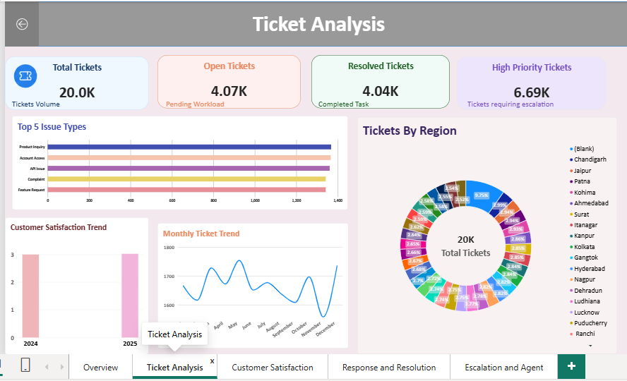
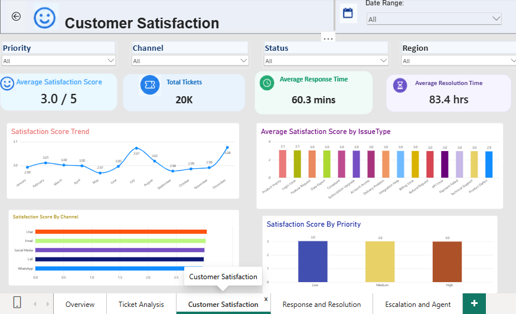
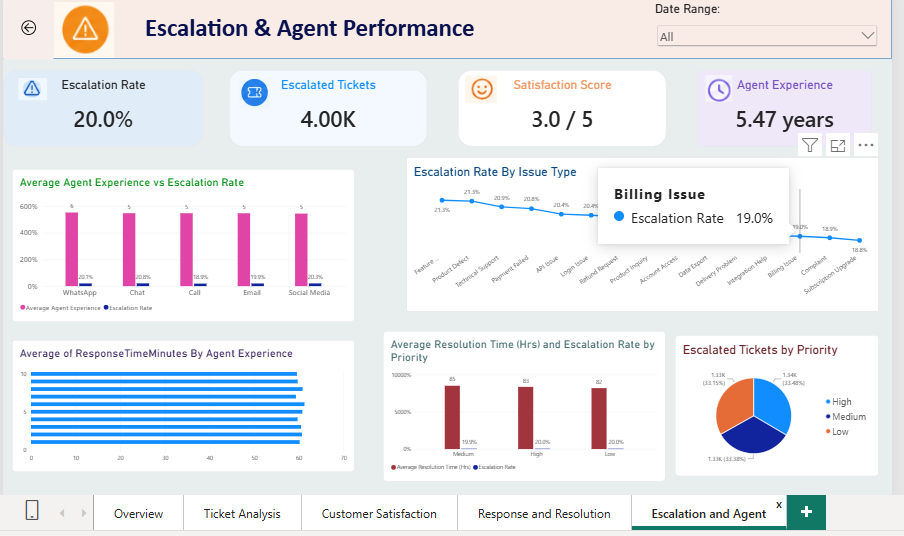

# 🎧 Customer Support Analytics Dashboard 📊

An interactive Power BI dashboard designed to analyze customer support operations, ticket trends, response and resolution efficiency, customer satisfaction, and agent performance.

## 🎯 Project Objectives

- Analyze customer support ticket trends.
- Monitor response and resolution times.
- Understand customer satisfaction levels.
- Track ticket priorities and escalations.
- Evaluate agent experience and performance.
- Identify trends across support channels and regions.

## 🛠️ Tools & Technologies

- **Power BI** – Dashboard development and visualization
- **Python** – Data processing
- **Pandas** – Data cleaning and analysis
- **Google Colab** – Data preparation and exploration

## 📊 Dashboard Preview

### 1. Overview


### 2. Ticket Analysis


### 3. Customer Satisfaction


### 4. Response and Resolution


### 5. Escalation and Agent Performance


## ✨ Key Features

- Interactive dashboard with KPI cards.
- Dynamic charts and visualizations.
- Filters for month, region, priority, status, and channel.
- Ticket status and priority analysis.
- Customer satisfaction analysis.
- Response and resolution performance monitoring.
- Escalation and agent performance analysis.
- Page navigation for easy exploration.

## 📁 Project Structure

```text
Customer-Support-Dashboard/
│
├── screenshots/
│   ├── overview.png
│   ├── ticket-analysis.png
│   ├── customer-satisfaction.png
│   ├── response-resolution.png
│   └── escalation-agent.png
│
├── Customer_Support_Dashboard.pbix
├── README.md
└── .gitignore
```

## 📂 Project File

**Power BI Report:** `Customer_Support_Dashboard.pbix`

Open the PBIX file using Microsoft Power BI Desktop to explore the interactive dashboard.

## 👩‍💻 Author

**Bhavana R**

